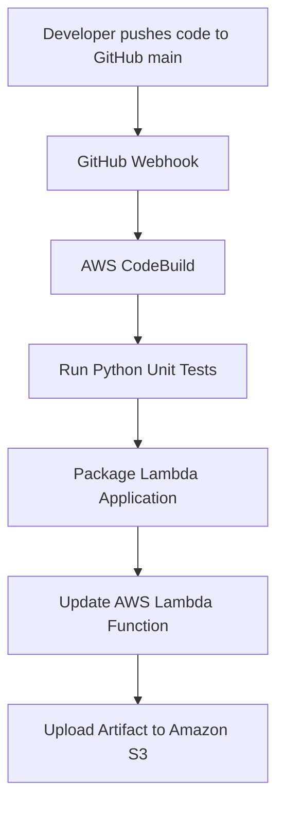

# Week 36: AWS Serverless CI/CD Pipeline

## Project Overview

This project demonstrates how to build an automated Continuous Integration and Continuous Deployment (CI/CD) pipeline for an AWS Lambda application using Terraform, GitHub, AWS CodeBuild, Amazon S3, and AWS Lambda.

The pipeline automatically detects code pushes to the `main` branch of the GitHub repository, triggers an AWS CodeBuild execution, runs Python unit tests, packages the Lambda application, deploys the updated code to AWS Lambda, and stores the build artifact in Amazon S3.

The infrastructure is provisioned and managed using Terraform.

## Project Objectives

- Provision AWS infrastructure using Terraform.
- Create and configure an AWS Lambda function.
- Configure IAM roles and permissions for CodeBuild.
- Connect a GitHub repository to AWS CodeBuild.
- Automate Python unit testing.
- Package Lambda application code into a ZIP deployment artifact.
- Automatically deploy updated Lambda code.
- Store build artifacts in Amazon S3.
- Configure GitHub webhooks for push-triggered builds.

## Architecture



### Architecture Components

| Service | Responsibility |
|---|---|
| GitHub | Source code repository and webhook event source |
| GitHub Webhook | Notifies CodeBuild when qualifying pushes occur |
| Terraform | Provisions and manages AWS infrastructure |
| AWS CodeBuild | Executes the CI/CD build process |
| AWS IAM | Controls permissions for AWS service interactions |
| AWS Lambda | Hosts the serverless Python application |
| Amazon S3 | Stores deployment artifacts |
| Amazon CloudWatch | Provides Lambda and CodeBuild logging |

## Technologies Used

- AWS Lambda
- AWS CodeBuild
- Amazon S3
- AWS IAM
- Amazon CloudWatch
- Terraform
- Python 3.12
- Git and GitHub
- AWS CLI
- Linux build environment

## Repository Structure

```text
week36-aws-serverless-cicd-pipeline/
│
├── lambda/
│   └── lambda_app.py
│
├── tests/
│   └── test_app.py
│
├── terraform/
├── deploymezip
│
├── README.md
└── .gitignore
```

Terraform state files and generated deployment artifacts are excluded from Git where appropriate through `.gitignore`.

## Application Overview

The Lambda application is written in Python 3.12.

The function accepts an incoming task through an event payload and returns a JSON response containing:

- A success message
- The submitted task
- A completion status
- A UTC timestamp

Example input:

```json
{
  "task": "Deploy Week 36 application"
}
```

Example application response:

```json
{
  "message": "Task processed successfully",
  "task": "Deploy Week 36 application",
  "status": "COMPLETED",
  "timestamp": "2026-11-14T22:49:01.740624+00:00"
}
```

## CI/CD Workflow

The pipeline follows these steps:

1. A developer pushes changes to the GitHub `main` branch.
2. GitHub sends a push event through the configured webhook.
3. AWS CodeBuild receives the event and starts a build.
4. CodeBuild retrieves the latest repository source.
5. The Python 3.12 build environment is initialized.
6. Python unit tests execute.
7. The Lambda application is packaged into `deployment.zip`.
8. CodeBuild updates the existing Lambda function using the AWS CLI.
9. The deployment artifact is uploaded to Amazon S3.

### Build Specification

The pipeline uses `buildspec.yml` to define its build instructions.

The build process includes:

- Installing the Python runtime.
- Running unit tests using Python's `unittest` framework.
- Packaging the Lambda application using ZIP.
- Deploying the package using `aws lambda update-function-code`.
- Publishing the deployment artifact to S3.

## GitHub Webhook Configuration

The CodeBuild webhook is managed through Terraform.

The webhook is configured to respond to:

- Event: `PUSH`
- Branch: `main`
- GitHub actor account ID: `264746440`

The webhook uses manual creation mode. Its generated payload URL and secret are registered in the GitHub repository's webhook settings.

The webhook secret must remain private and must never be committed to GitHub.

## Infrastructure Provisioning

Terraform manages the AWS resources required by the project.

### Initialize Terraform

```bash
terraform -chdir=terraform init
```

### Validate Configuration

```bash
terraform -chdir=terraform validate
```

### Review Infrastructure Changes

```bash
terraform -chdir=terraform plan
```

### Apply Infrastructure

```bash
terraform -chdir=terraform apply
```

Review the Terraform plan before approving infrastructure changes.

## Testing and Verification

### Run Unit Tests Locally

```bash
python3 -m unittest discover -s tests -v
```

The test suite checks:

- Processing a valid task.
- Handling a missing task.
- Generating a timestamp.

Three unit tests were successfully executed locally.

### Verify Lambda Deployment

```bash
aws lambda get-function-configuration \
  --function-name week36-serverless-task-processor \
  --region us-east-1
```

### Invoke the Lambda Function

```bash
aws lambda invoke \
  --function-name week36-serverless-task-processor \
  --region us-east-1 \
  --cli-binary-format raw-in-base64-out \
  --payload '{"task":"Verify automated CI/CD deployment"}' \
  response.json
```

Inspect the response:

```bash
cat response.json
```

### Verify CodeBuild Executions

```bash
aws codebuild list-builds-for-project \
  --project-name week36-serverless-cicd-build \
  --region us-east-1
```

### Verify S3 Artifacts

```bash
aws s3 ls \
  s3://week36-serverless-cicd-artifacts-906446636895-us-east-1/ \
  --recursive
```

## Deployment Results

The project was successfully tested through four CodeBuild executions.

| Build | Trigger | Result |
|---|---|---|
| Build #1 | Manual | Succeeded |
| Build #2 | Manual | Succeeded |
| Build #3 | Manual | Succeeded |
| Build #4 | GitHub push | Succeeded |

The fourth build confirmed that:

- GitHub successfully triggered CodeBuild.
- CodeBuild retrieved the correct Git commit.
- Python unit tests completed successfully.
- Lambda deployment completed successfully.
- S3 artifact upload completed successfully.
- The Lambda function remained active after deployment.

The final Lambda invocation returned status code `200` and the expected application response.

## Security Considerations

- CodeBuild uses a dedicated IAM service role.
- Lambda execution uses a separate IAM role.
- CodeBuild permissions are scoped to the required Lambda function and S3 bucket.
- S3 public access is blocked.
- S3 server-side encryption and versioning are enabled.
- The GitHub webhook is filtered by event, branch, and actor account ID.
- Webhook secrets and Terraform state files must not be committed to the repository.

## Challenges and Lessons Learned

### 1. IAM Permissions

Configured a dedicated CodeBuild IAM role and added the required Lambda code-update permission.

### 2. Artifact Packaging

Configured CodeBuild artifact packaging to avoid unnecessarily wrapping the already-created Lambda ZIP file.

### 3. S3 Artifact Paths

Investigated an unexpected S3 object path and used `aws s3api head-object` to verify the actual artifact.

### 4. Terraform Resource Organization

Separated Lambda IAM configuration from CodeBuild IAM and project configuration to keep the infrastructure organized.

### 5. GitHub Webhooks

Configured a GitHub webhook using Terraform and verified successful communication with AWS.

### 6. Automated Deployment

Tested the complete workflow by pushing a README update to GitHub and confirming that CodeBuild automatically deployed the application.

## Future Improvements

- Add deployment approval stages.
- Implement safer deployment strategies and rollback procedures.
- Add integration tests.
- Improve build notifications.
- Introduce separate development and production environments.
- Add deployment monitoring and alarms.
- Improve artifact retention and lifecycle management.

## Project Outcome

This project demonstrates practical experience with AWS serverless computing, Infrastructure as Code, IAM security, automated testing, CI/CD, GitHub integration, artifact management, and automated Lambda deployments.

The final implementation successfully demonstrates an event-triggered deployment workflow from GitHub to AWS Lambda.

---

**Project:** Week 36 – AWS Serverless CI/CD Pipeline
**Repository:** [week36-aws-serverless-cicd-pipeline](https://github.com/olusola-systems/week36-aws-serverless-cicd-pipeline)
**Cloud Provider:** Amazon Web Services
**Infrastructure as Code:** Terraform
**Application Runtime:** Python 3.12

